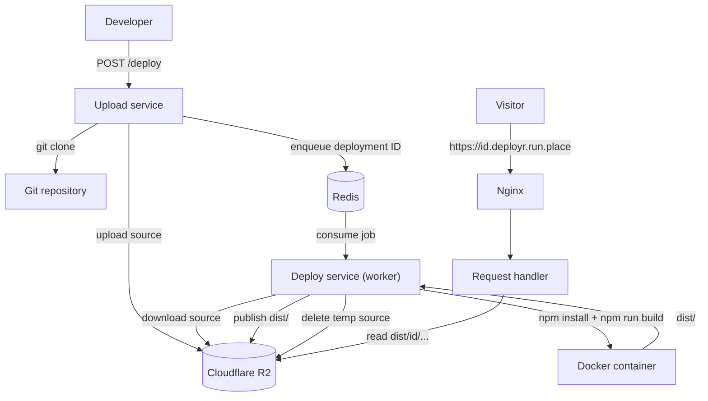

<div align="center">


# Deployr

**Git repository in. HTTPS deployment out.**

A self-hosted deployment platform for static frontend apps, built with Node.js, TypeScript, Redis, Docker, and Cloudflare R2.

[](#project-status)
[](https://nodejs.org/)
[](https://www.typescriptlang.org/)
[](https://www.docker.com/)
[](https://www.cloudflare.com/developer-platform/r2/)
[](#license)

[Overview](#overview) · [How it works](#how-it-works) · [Quick start](#quick-start) · [API](#api-reference) · [Configuration](#configuration) · [Limitations](#limitations-and-security) · [Roadmap](#roadmap)

</div>

---

## Overview

Deployr takes a public Git repository URL and turns it into a live website.

```text
https://github.com/<owner>/<repository>   ──►   https://<deployment-id>.deployr.run.place
```

You send a repository URL to the API. Deployr then:

1. Clones the repository.
2. Stores the source in Cloudflare R2.
3. Queues a build job in Redis.
4. Builds the project inside a Docker container.
5. Uploads the built `dist/` folder to R2.
6. Serves the site on its own HTTPS subdomain.

Deployr is inspired by Vercel and Netlify, but it is intentionally small and readable so you can see every step of a deployment pipeline.

> **Scope:** static frontend apps only. Deployr is not a server-side or backend hosting platform.

## Project status

> **Early-stage, single-tenant prototype.** The core pipeline works end to end. Deployr must **not** be used as a public service for untrusted repositories yet. See [Limitations and security](#limitations-and-security).

| Area | Status |
|---|---|
| Git clone and source staging in R2 | ✅ Implemented |
| Redis build queue | ✅ Implemented |
| Docker build worker | ✅ Implemented |
| Static output publishing to R2 | ✅ Implemented |
| HTTPS deployment URLs | ✅ Implemented |
| Source cleanup in R2 after successful publish | ✅ Implemented |
| Local temp cleanup | ✅ Implemented |
| Status API | ✅ Implemented |
| Next.js dashboard | 🚧 In development |
| Authentication and multi-user support | 🗓️ Planned |
| Build log API and deployment history | 🗓️ Planned |

## Features

- Deploy any public Git repository with one HTTP request.
- Asynchronous builds: the API responds as soon as the job is queued.
- Isolated builds in ephemeral Docker containers (1 GB memory, 1 CPU).
- Source and build output stored in Cloudflare R2.
- Unique HTTPS URL per deployment through wildcard DNS and TLS.
- Status tracking: `Uploaded`, `Building`, `Deployed`, `Failed`.
- Staged source is deleted from R2 after a successful publish and kept after a failed build for debugging.

## How it works



### Services

| Service | Role | Port |
|---|---|---|
| `deployr-upload-service` | Accepts deployments, clones repos, stages source, queues jobs, serves status | `3000` |
| `deployr-deploy-service` | Worker: consumes jobs, runs Docker builds, publishes output, updates status | none |
| `deployr-request-handler` | Serves published files based on the hostname | `3001` |
| `deployr-frontend` | Next.js dashboard (in development) | `3002` (planned) |

Backend services listen on loopback only. Nginx is the only public entry point.

### Deployment lifecycle

1. The client sends the repository URL to `POST /deploy`.
2. The upload service generates a deployment ID and clones the repository.
3. Source files (without `.git`) are uploaded to `temp/<deployment-id>/` in R2.
4. The ID is pushed to the Redis queue and the status is set to `Uploaded`.
5. The worker picks up the job and sets the status to `Building`.
6. The worker downloads the source and runs `npm install && npm run build` in Docker.
7. The worker uploads the generated `dist/` files to `dist/<deployment-id>/` in R2.
8. The worker deletes `temp/<deployment-id>/` from R2 and sets the status to `Deployed`.
9. The request handler serves the site at `https://<deployment-id>.deployr.run.place`.

If the build or output upload fails, the status becomes `Failed` and the staged source stays in R2 so the failure can be investigated.

### Statuses

| Status | Meaning |
|---|---|
| `Uploaded` | Source is staged and the job is queued |
| `Building` | The worker is building the project |
| `Deployed` | Build output is published |
| `Failed` | Something went wrong |
| `null` | Unknown deployment ID |

## Technology stack

| Layer | Technology |
|---|---|
| Frontend | Next.js (App Router), React, TypeScript, Tailwind CSS, shadcn/ui |
| Backend | Node.js 22, TypeScript, Express |
| Git | `simple-git` |
| Queue and status | Redis |
| Object storage | Cloudflare R2 via AWS SDK for JavaScript v3 |
| Builds | Docker (`node:20-alpine`) |
| Proxy and TLS | Nginx, Let's Encrypt (Certbot) |
| Process manager | systemd |
| Hosting | Oracle Cloud Infrastructure (Ubuntu VM) |
| CI/CD | GitHub Actions |

## Repository structure

```text
Deployr/
├── .github/workflows/deploy.yml   # CI build + SSH deploy
├── assets/logo.svg                # Project logo
├── deployr-frontend/              # Next.js dashboard (in development)
├── deployr-upload-service/        # Upload + status API
├── deployr-deploy-service/        # Build worker
├── deployr-request-handler/       # Static file server
├── PRD.md                         # Product requirements
├── TDD.md                         # Technical design
└── README.md
```

Each service has its own `package.json` and is installed and built separately. The repository is not an npm workspace.

---

## Quick start

### Prerequisites

- Git
- Node.js 22.x and npm
- Redis running on `127.0.0.1:6379`
- Docker Engine (the user running the worker must be allowed to run `docker`)
- A Cloudflare R2 bucket named `deployr` and S3 API credentials

### 1. Clone and build

```bash
git clone https://github.com/NITISH084/Deployr.git
cd Deployr

for service in deployr-upload-service deployr-deploy-service deployr-request-handler; do
  (cd "$service" && npm ci && npm run build)
done
```

### 2. Configure R2

Create a **private** R2 bucket named `deployr` and an S3 API token with read/write access. Then create a `.env` file in **each** of the three backend service folders:

```dotenv
accessKeyId=<R2_ACCESS_KEY_ID>
secretAccessKey=<R2_SECRET_ACCESS_KEY>
endpoint=https://<CLOUDFLARE_ACCOUNT_ID>.r2.cloudflarestorage.com
```

Variable names are case-sensitive. Never commit `.env` files.

### 3. Start Redis

```bash
redis-server
# or
docker run --rm -p 127.0.0.1:6379:6379 redis:7
```

### 4. Start the services

Run each in its own terminal, **from its own folder** (so `.env` is found):

```bash
cd deployr-upload-service   && npm start    # API on :3000
cd deployr-deploy-service   && npm start    # worker
cd deployr-request-handler  && npm start    # file server on :3001
```

### 5. Deploy a test project

Use a public repo that has a root `package.json` and a build script that outputs to `dist/` (a default Vite project works).

```bash
curl -X POST http://localhost:3000/deploy \
  -H "Content-Type: application/json" \
  -d '{"repoURL":"https://github.com/owner/repository"}'
# {"id":"abc12"}

curl "http://localhost:3000/status?id=abc12"
# {"status":"Deployed"}
```

View the site locally by sending the deployment hostname to the request handler:

```bash
curl -i -H "Host: abc12.deployr.run.place" http://localhost:3001/
```

### 6. Start the dashboard (optional, in development)

```bash
cd deployr-frontend
npm ci
echo "NEXT_PUBLIC_API_URL=http://localhost:3000" > .env.local
npm run dev
```

---

## Project requirements

For a repository to deploy successfully it must:

1. Be public and clonable without credentials.
2. Have a `package.json` in the repository root.
3. Install with `npm install` on Node 20 (Alpine Linux).
4. Build with `npm run build` and exit with code `0`.
5. Write static output to a `dist/` folder in the repository root, containing `index.html`.

| Framework | Works as-is? |
|---|---|
| Vite | ✅ Yes (outputs `dist/`) |
| Astro (static) | ✅ Yes (outputs `dist/`) |
| Create React App | ❌ Outputs `build/`; change it to `dist/` |
| Next.js static export | ❌ Outputs `out/`; change it to `dist/` |
| Server-rendered apps | ❌ Not supported |

---

## API reference

Base URL: `http://localhost:3000` locally, `https://api.deployr.run.place` in production.

### `POST /deploy`

Submit a public repository for deployment.

**Request body**

```json
{ "repoURL": "https://github.com/owner/repository" }
```

**Success (200)**

```json
{ "id": "abc12" }
```

This means the source is staged and the build is queued. It does **not** mean the build is finished. Poll `/status` to follow progress.

**Failure (500)**

```json
{ "error": "Failed to queue deployment" }
```

### `GET /status?id=<deployment-id>`

```json
{ "status": "Building" }
```

Values: `Uploaded`, `Building`, `Deployed`, `Failed`, or `null` for an unknown ID. Treat `Deployed` and `Failed` as final.

### Deployment URL

```text
https://<deployment-id>.deployr.run.place
```

The request handler takes the first part of the hostname as the deployment ID and serves the matching file from `dist/<deployment-id>/` in R2. `/` maps to `index.html`.

---

## Configuration

| Variable | Required | Used by | Purpose |
|---|---|---|---|
| `accessKeyId` | Yes | All backend services | R2 access key ID |
| `secretAccessKey` | Yes | All backend services | R2 secret key |
| `endpoint` | Yes | All backend services | R2 S3 API endpoint |
| `DEPLOYR_TEMP_DIR` | No | Upload service, worker | Custom temp folder. The folder name must end in `temp` |
| `NEXT_PUBLIC_API_URL` | Frontend only | Dashboard | URL of the upload API |

Never put R2 credentials in a `NEXT_PUBLIC_*` variable.

Hard-coded values: the bucket name is `deployr`, Redis is `redis://127.0.0.1:6379`, and ports are `3000` and `3001`.

## Storage layout

```text
deployr (R2 bucket)
├── temp/<deployment-id>/   # staged source, deleted after a successful publish
└── dist/<deployment-id>/   # published site, kept for serving
```

## Production setup

Deployr runs on a single Oracle Cloud Ubuntu VM:

- **Nginx** terminates HTTPS and forwards `api.deployr.run.place` to port `3000` and `*.deployr.run.place` to port `3001`. It must keep the original `Host` header.
- **systemd** runs the three backend services: `deployr-upload.service`, `deployr-worker.service`, `deployr-request.service`.
- **Redis** and the Node services listen on loopback only.
- **Wildcard DNS and TLS** (`*.deployr.run.place`) give every deployment its own HTTPS hostname. The wildcard certificate does not cover the root domain `deployr.run.place`.
- **GitHub Actions** builds the services and deploys to the VM over SSH on every push to `master`.

Required GitHub Actions secrets:

| Secret | Purpose |
|---|---|
| `DEPLOY_HOST` | VM public IP or hostname |
| `DEPLOY_USER` | SSH username |
| `DEPLOY_SSH_KEY` | Private deployment key |
| `DEPLOY_KNOWN_HOSTS` | Full SSH known-hosts line for the VM |

Keep SSH host verification enabled. Never commit keys or credentials.

---

## Limitations and security

Deployr is a prototype. Resource limits on Docker are **not** a security sandbox: a repository can run arbitrary code during `npm install` and `npm run build`.

**Do not run untrusted public builds until these are fixed:**

- No authentication, rate limiting, or quotas.
- No repository URL validation or SSRF protection.
- Symlinks in repositories are followed and could expose host files.
- Build containers have unrestricted network access and no build timeout.
- Deployment IDs are 5 random characters with no collision check.
- Output upload is not atomic; a partial site can be served.

**Known functional limitations:**

- Public repositories only.
- The build runs at the repository root only (no monorepo subfolders).
- One worker, one build at a time.
- No queue retries: if the worker crashes mid-job, the job is lost.
- No SPA fallback: a route like `/about` looks for an exact file.
- No build log API (logs go to the worker's service logs).
- No custom domains, preview deployments, rollbacks, or environment variables.

## Roadmap

**Reliability**
- [ ] Queue acknowledgements, retries, crash recovery
- [ ] Build timeouts and disk/output quotas
- [ ] Structured logs and a build log API
- [ ] Health checks and automated tests

**Security**
- [ ] Authentication and project ownership
- [ ] Repository URL validation and SSRF protection
- [ ] Symlink protection and stronger build isolation
- [ ] Rate limits and quotas

**Developer experience**
- [ ] Complete the dashboard
- [ ] Deployment history and live build logs
- [ ] Preview and branch deployments
- [ ] Custom domains and environment variables
- [ ] Rollbacks

## Contributing

Contributions and feedback are welcome.

1. Fork the repository.
2. Create a branch: `git checkout -b feat/your-change`.
3. Make your change and build the affected service(s).
4. Test the behavior you changed.
5. Update the documentation if needed.
6. Open a pull request with a clear summary and test steps.

Do not commit `.env` files, `node_modules/`, generated `dist/` output, or runtime `temp/` folders.

For security issues, do not post exploit details in a public issue. Use GitHub's private vulnerability reporting if it is enabled.

## License

The backend packages declare the **ISC** license. Add a `LICENSE` file to the repository root to make the terms explicit.

---

<div align="center">

**Built to understand the infrastructure behind a deployment.**

[Back to top](#deployr)

</div>